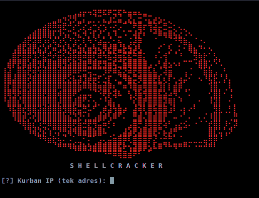

<div align="center">

# ShellCracker

### One command, one target: recon to shell, unattended.

A terminal-based exploitation pipeline that chains reconnaissance, exploit
matching, validation and firing into a single run. Give it one target IP and it
scans, selects candidate exploits, fires them through a reverse handler until a
session lands, verifies that session, and hands you an interactive shell.


-2e7d32?style=for-the-badge)


</div>

<div align="center">

<br/>
<sub>Acilis arayuzu — banner ve tek-hedef IP istemi.</sub>
</div>

---

<div align="center">

</div>

## Overview

ShellCracker automates the full chain from a single target IP to a working
session. Instead of running `nmap`, `searchsploit` and Metasploit by hand and
wiring a reverse handler each time, you give it one address and it drives those
already-installed tools for you, logging each step along the way.

It is an orchestration layer with a decision engine on top: it does **not**
contain or develop exploit code of its own. Reconnaissance is delegated to
`nmap`, web attack-surface analysis to `whatweb`/`nuclei`/`gobuster`/`nikto`,
exploit/auxiliary selection to the Metasploit module database and Exploit-DB,
and every attempt runs through the Metasploit framework over `msfrpc`. What
ShellCracker adds is the **autonomous strategy** — it profiles
the target, builds a scored per-service attack plan, and adapts that plan to
what it learns as it runs (see [Autonomous engine](#autonomous-engine)).

- **Zero-setup run** — `msfrpcd` is started automatically if it is not already
  running, and `LHOST` is detected from the route to the target, so a basic run
  needs no config editing.
- **Interactive handoff** — when a session is verified, ShellCracker opens the
  shell in a new terminal window and leaves you in it to type commands.
- **Turkish interface** — the user-facing output is in Turkish; the code,
  configuration and this README are in English.

---

## Methodology

<div align="center">

</div>

1. **Target** — start from a single lab IP you own or are authorized to test.
2. **Recon** — `nmap -sV -Pn` (optionally `-O`/`-sC`) discovers open services.
3. **Profile** — recon is turned into a target model: an OS-family guess and
   every service sorted into a category (web / smb / ftp / ssh / db / ...).
4. **Vulnerability analysis** — each service is matched against a curated
   knowledge base of high-signal exploits *and* the live Metasploit module DB;
   web services additionally get an active external-tool pass (`whatweb`,
   `nuclei`, `gobuster`/`ffuf`, `nikto`) whose findings widen the plan.
5. **Strategy** — the brain walks a broad per-category decision tree and builds
   a **scored, phased attack plan** covering every avenue it can see.
6. **Execute** — the plan runs phase by phase and **adapts**: enumeration and
   web-scan findings feed back and reshape what gets fired next; `hydra`
   credential attacks run against login services, and any discovered credential
   is reused across every other service and unlocks credential-gated exploits.
7. **Post-exploitation** — a landed session is triaged automatically: who am I,
   am I privileged, privilege-escalation paths, low-risk loot, and offline
   cracking of any looted hashes (`john`/`hashcat`) back into usable passwords.
8. **Shell** — the verified session is handed to you interactively in a new
   terminal window, already triaged.

Only a single explicitly provided IP is ever touched.

---

## Autonomous engine

The point of ShellCracker is that it *reasons* about the target instead of
running a fixed list. After recon, the [`profiler`](core/profiler.py) builds a
`TargetProfile` and the [`strategy`](core/strategy.py) engine turns it into an
`AttackPlan` of scored `AttackVector`s, grouped into phases that run in order —
cheap and safe first, loud and intrusive last — then the executor runs them
adaptively and, on success, hands off to [`postexp`](core/postexp.py).

### Phases

| Phase | What it does | Example modules / tools |
|---|---|---|
| **enumerate** | low-risk intel gathering; feeds the feedback loop | `smb_version`, `smb_ms17_010`, `ftp/anonymous`, `http_header`, `smtp_enum`, `snmp_enum`, `nfsmount` |
| **vulnscan** | active external-tool web pass; findings widen the plan | `whatweb`, `nuclei`, `gobuster`/`ffuf`, `nikto` |
| **bruteforce** | wordlist credential attacks; a hit is tried straight into a session | `hydra` (ssh/ftp/smb/mysql/mssql/postgres/rdp/vnc/telnet/…) |
| **exploit** | knowledge-base + version-matched MSF exploits, behind a reverse handler | `vsftpd_234_backdoor`, `ms17_010_eternalblue`, `samba/usermap_script`, `struts2_content_type_ognl`, `tomcat_jsp_upload_bypass`, `docker_daemon_tcp`, plus whatever `modules.search` returns |
| **credentials** | default/weak-login checks, then credential **reuse** across services | `ssh_login`, `smb_login`, `ftp_login`, `mysql_login`, `vnc_login` |
| **misconfig** | abuse of exposed configuration | NFS exports, writable shares, anonymous access |
| **post-exploitation** | automatic triage of every landed session | `local_exploit_suggester`, `getsystem`, `sudo -l`, SUID sweep, `hashdump` |

### Active vuln-scan phase (external tools)

Between enumeration and exploitation, the **vulnscan** phase points a suite of
best-in-class CLI tools at the target's web services and turns their output into
findings that feed straight back into the plan (see
[`webenum`](core/webenum.py) + the uniform external-tool runner
[`tools`](core/tools.py)):

- `whatweb` — technology/product fingerprinting;
- `nuclei` — thousands of template-based CVE / misconfig / exposure checks;
- `gobuster` / `ffuf` — hidden directory & file discovery;
- `nikto` — classic web-server issues (opt-in; slower).

A product fingerprinted here (Drupal, Tomcat, Struts, Jenkins, …) or a path it
uncovers (`/manager/html`, `/wp-login.php`, …) becomes a `product` finding,
which the engine immediately converts into knowledge-base and version-matched
exploit vectors **before** the exploit phase runs. Every tool is optional:
whatever is not installed is skipped with a note, never a crash, so ShellCracker
runs on whatever subset a given box has.

### Three sources of attacks

For every service the engine draws candidates from three places, so it never
depends on a single heuristic:

1. **Per-category playbook** — a declarative decision tree (`_PLAYBOOK` in
   [`strategy.py`](core/strategy.py)): the enumeration + login modules that make
   sense for each category (ftp, ssh, smb, web, mysql, mssql, postgres, oracle,
   redis, mongodb, rpc/nfs, snmp, smtp, pop3, rdp, vnc, finger, r-services,
   irc, java-rmi, …). Adding a technique is a one-line change.
2. **Knowledge base of high-signal exploits** (`_KNOWN_EXPLOITS`) — curated
   fingerprint → exploit rules for the classics (vsftpd 2.3.4, ProFTPD 1.3.3c,
   UnrealIRCd, Samba `usermap_script`, distcc, Java-RMI, Shellshock, PHP-CGI,
   Drupalgeddon2, EternalBlue, MS08-067) **and modern/high-prevalence targets**
   (Struts2 S2-045/S2-057, Tomcat JSP-upload + Manager, Jenkins, JBoss, CouchDB,
   Elasticsearch Groovy, unprotected Docker API, Confluence OGNL, Joomla,
   WordPress admin upload, Apache 2.4.49 path traversal, …). These are injected
   directly and get a *killer bonus* so they outrank noisy search hits.
3. **Version-matched MSF net** — `modules.search` per service, ranked by MSF
   reliability and by how specifically the module matches the detected version.

### Scoring

Within a phase, higher-scored vectors go first:

```
score = category_weight          (smb/ftp/web rank above dns/finger)
      + rank_points               (MSF reliability: excellent … manual)
      + version_match_points      (exact product+version in the module → +20)
      + killer_bonus              (curated knowledge-base exploits)
      - noise_penalty             (credential spraying scores lower)
```

All weights live under `strategy.weights` in the config.

### Adaptive feedback

This is what makes it autonomous — enumeration findings are fed back into the
engine, which boosts or injects vectors mid-run:

- `smb_ms17_010` reports *vulnerable* → **EternalBlue** is promoted to top score.
- a valid credential is found → it is **reused** against every other login
  service, and credential-gated exploits (**psexec**, Tomcat Manager upload,
  Postgres/MySQL payload) are unlocked for it.
- anonymous FTP / null SMB session / NFS exports / refined product banners →
  recorded as facts and used to widen the plan.

### Post-exploitation

When a session is verified the [`postexp`](core/postexp.py) module triages it
automatically before handing you a shell: it identifies the user and privilege
level, then on meterpreter runs `getsystem` + `local_exploit_suggester`, and on
a shell enumerates the Linux privesc surface (`sudo -l`, SUID/GTFOBins sweep,
kernel version, cron) and suggests concrete escalation paths. Loot is read-only
and proportionate (`/etc/passwd`, or `/etc/shadow` + `hashdump` only once
privileged); any hashes looted are then handed to `john` (or `hashcat`) for an
offline, time-boxed crack and the recovered passwords are added to the
credential pool. Firing crash-prone exploits or live kernel privesc stays gated
behind `strategy.allow_dangerous`.

---

## Pipeline

| Stage | What happens |
|---|---|
| Recon | `nmap -sV -Pn` (+`-O`/`-sC` optional), XML parsed into structured services |
| Profile | OS-family inference + per-category service grouping into a `TargetProfile` |
| Strategy | per-category decision tree + MSF search → a scored, phased `AttackPlan` |
| Enumerate | auxiliary scanners gather intel; findings feed back into the plan |
| Vuln-scan | external web tools (`whatweb`/`nuclei`/`gobuster`/`nikto`) widen the plan |
| Brute-force | `hydra` wordlist attacks on login services; a hit is tried into a session |
| Exploit | knowledge-base + version-matched modules, `check()` dry-run, fired by score |
| Credentials | default/weak-login checks + reuse; a success can drop a session directly |
| Verify | a harmless command confirms the session and captures proof |
| Post-exp | automatic triage: whoami, privilege check, privesc suggestions, loot |
| Handoff | the interactive shell opens in a new terminal window |

---

## Safeguards

ShellCracker is built for **your own virtual machines and sanctioned training
environments** (Metasploitable, Hack The Box, TryHackMe, OSCP-style labs).

- **One IP only** — `--target` accepts a single IP address; CIDR, ranges, lists
  and input files are rejected. There is no mass-scanning mode.
- **No hardcoded targets** and **no internet-facing scan mode**.
- **Clean interrupt** — `Ctrl+C` stops immediately and tears down only the
  sessions ShellCracker itself opened.

Using it against systems you do not own or lack explicit written permission to
test is illegal in most jurisdictions. You are solely responsible for having
authorization.

---

## Architecture

```
Siber-ShellCracker/
├── shell.py              # entry: startup animation, banner, orchestration
├── attach.py             # standalone session attach (used by the new window)
├── core/
│   ├── recon.py          # nmap service/version (+optional -O/-sC) discovery
│   ├── profiler.py       # recon -> TargetProfile (OS guess, categories, facts)
│   ├── strategy.py       # the brain: profile -> scored, phased AttackPlan
│   ├── matcher.py        # services -> ranked candidate exploits (MSF + EDB)
│   ├── tools.py          # uniform external-CLI runner (which/run/timeout)
│   ├── webenum.py        # vulnscan phase: whatweb/nuclei/gobuster/nikto -> findings
│   ├── bruteforce.py     # bruteforce phase: hydra credential attacks -> findings
│   ├── executor.py       # msfrpc: run exploit/aux/login vectors, adaptive loop
│   ├── postexp.py        # post-exploitation: whoami, privesc, loot after a shell
│   ├── interactive.py    # interactive bridge to a live session
│   ├── reporter.py       # JSON + Markdown report (optional)
│   └── colors.py         # dependency-free ANSI colouring
├── config.yaml.example   # copy to config.yaml (sane lab defaults)
├── requirements.txt
└── LICENSE
```

---

## Requirements

| Component | Notes |
|---|---|
| Python 3.12+ | with `python-nmap`, `pymetasploit3`, `PyYAML` |
| nmap, searchsploit | standard on Kali |
| Metasploit Framework | `msfconsole`, `msfrpcd`, `msfvenom` |
| Web tools *(optional)* | `whatweb`, `nuclei`, `gobuster`/`ffuf`, `nikto` — power the vulnscan phase; skipped if absent |
| Cred tools *(optional)* | `hydra` (bruteforce phase), `john`/`hashcat` (offline hash cracking); skipped if absent |
| Linux + root | nmap `-sV` and `msfrpcd` run best as root |
| Lab network access | a reachable target you are authorized to test |

---

## Installation

```bash
git clone https://github.com/osmnabyram/Siber-ShellCracker.git
cd Siber-ShellCracker

pip install -r requirements.txt
cp config.yaml.example config.yaml
```

Defaults work out of the box for a local lab: `handler.lhost` is `auto`
(detected from the route to the target) and `msfrpcd` is auto-started with the
user/password/port in `config.yaml` (default `msf` / `msf` / `55553`).

---

## Usage

Run it and enter the target when asked:

```bash
python3 shell.py
```

```text
Sistem aciliyor      Hosgeldiniz

                 S H E L L C R A C K E R

[?] Kurban IP (tek adres): 192.168.56.101
    Hedef: 192.168.56.101
    LHOST: 192.168.56.1  (otomatik)

═══[ KESIF ]═══ ...
═══[ PROFIL ]═══ ...
═══[ STRATEJI ]═══ ...
═══[ SOMURU ]═══ ...

  ╔══════════════════════════════════════╗
  ║  SHELL ALINDI  —  oturum 1 (shell)
  ╚══════════════════════════════════════╝
```

On success the interactive shell opens in a **new terminal window** by default.
You can also pass the target non-interactively:

```bash
python3 shell.py --target 192.168.56.101
```

| Flag | Description |
|---|---|
| `--target <IP>` | Single target IP. CIDR/ranges/lists rejected. If omitted, you are prompted. |
| `--config <path>` | Config file (default `config.yaml`). |
| `--rapor` | Write JSON + Markdown report, logfile and raw nmap XML to `reports/` (off by default). |
| `--ayni-pencere` | Attach to the shell in THIS window instead of opening a new terminal. |

Exit codes: `0` success / clean no-op, `1` cancelled or error, `3` msfrpc
unreachable, `4` no shell obtained.

### Optional: start msfrpcd yourself

Auto-start covers the common case. To run the daemon manually (for example to
watch its output), start it first and ShellCracker will reuse it:

```bash
msfrpcd -U msf -P msf -p 55553 -a 127.0.0.1
```

---

## License

[MIT](LICENSE). Provided as-is, for authorized security education and testing.
