<div align="center">

# ShellCracker

### One command, one target: recon to shell, unattended.

A terminal-based exploitation pipeline that chains reconnaissance, exploit
matching, validation and firing into a single run. Give it one target IP and it
scans, selects candidate exploits, fires them through a reverse handler until a
session lands, verifies that session, and hands you an interactive shell.


-2e7d32?style=for-the-badge)


</div>

<!-- Optional: drop a terminal screenshot here, e.g.
<div align="center"></div>
-->

---

<div align="center">

</div>

## Overview

ShellCracker automates the full chain from a single target IP to a working
session. Instead of running `nmap`, `searchsploit` and Metasploit by hand and
wiring a reverse handler each time, you give it one address and it drives those
already-installed tools for you, logging each step along the way.

It is an orchestration layer with a decision engine on top: it does **not**
contain or develop exploit code of its own. Reconnaissance is delegated to
`nmap`, exploit/auxiliary selection to the Metasploit module database and
Exploit-DB, and every attempt runs through the Metasploit framework over
`msfrpc`. What ShellCracker adds is the **autonomous strategy** — it profiles
the target, builds a scored per-service attack plan, and adapts that plan to
what it learns as it runs (see [Autonomous engine](#autonomous-engine)).

- **Zero-setup run** — `msfrpcd` is started automatically if it is not already
  running, and `LHOST` is detected from the route to the target, so a basic run
  needs no config editing.
- **Interactive handoff** — when a session is verified, ShellCracker opens the
  shell in a new terminal window and leaves you in it to type commands.
- **Turkish interface** — the user-facing output is in Turkish; the code,
  configuration and this README are in English.

---

## Methodology

<div align="center">

</div>

1. **Target** — start from a single lab IP you own or are authorized to test.
2. **Recon** — `nmap -sV -Pn` (optionally `-O`/`-sC`) discovers open services.
3. **Profile** — recon is turned into a target model: an OS-family guess and
   every service sorted into a category (web / smb / ftp / ssh / db / ...).
4. **Strategy** — the autonomous brain walks a broad per-category decision tree
   and builds a **scored, phased attack plan** covering every avenue it can see.
5. **Execute** — the plan runs phase by phase and **adapts**: enumeration
   findings feed back and reshape what gets fired next.
6. **Shell** — a landed session is verified with a harmless command, then
   handed to you interactively in a new terminal window.

Only a single explicitly provided IP is ever touched.

---

## Autonomous engine

The point of ShellCracker is that it *reasons* about the target instead of
running a fixed list. After recon, the [`profiler`](core/profiler.py) builds a
`TargetProfile` and the [`strategy`](core/strategy.py) engine turns it into an
`AttackPlan` of scored `AttackVector`s, grouped into four phases that run in
order — cheap and safe first, loud and destructive last:

| Phase | What it does | Example modules |
|---|---|---|
| **enumerate** | low-risk intel gathering; feeds the feedback loop | `smb_version`, `smb_ms17_010`, `ftp/anonymous`, `http_header`, `snmp_enum` |
| **exploit** | version-matched MSF exploits, fired behind a reverse handler | whatever `modules.search` returns for each service, ranked |
| **credentials** | default/weak-login checks (lab only, opt-out) | `ssh_login`, `smb_login`, `ftp_login`, `mysql_login` |
| **misconfig** | abuse of exposed configuration | NFS exports, writable shares, anonymous access |

**Scoring.** Within a phase, higher-scored vectors go first:

```
score = category_weight          (smb/ftp/web rank above dns/irc)
      + rank_points               (MSF reliability: excellent … manual)
      + version_match_points      (exact product+version in the module → +20)
      - noise_penalty             (credential spraying scores lower)
```

All weights live under `strategy.weights` in the config.

**Adaptive feedback.** This is what makes it autonomous. Enumeration findings
are fed back into the engine, which boosts or injects vectors mid-run:

- `smb_ms17_010` reports *vulnerable* → **EternalBlue** is injected at top score.
- a valid SMB credential is found → a **psexec** vector is injected with it.
- anonymous FTP / null SMB session / refined product banners → recorded as
  facts and used to widen the plan.

**Decision tree.** Each service category has its own playbook in
[`strategy.py`](core/strategy.py) (`_plan_ftp`, `_plan_smb`, `_plan_web`,
`_plan_mysql`, …), so adding a new technique is a localised change.

---

## Pipeline

| Stage | What happens |
|---|---|
| Recon | `nmap -sV -Pn` (+`-O`/`-sC` optional), XML parsed into structured services |
| Profile | OS-family inference + per-category service grouping into a `TargetProfile` |
| Strategy | per-category decision tree + MSF search → a scored, phased `AttackPlan` |
| Enumerate | auxiliary scanners gather intel; findings feed back into the plan |
| Exploit | compatible reverse payload selected, `check()` dry-run, fired by score |
| Credentials | default/weak-login checks; a success can drop a session directly |
| Verify | a harmless command confirms the session and captures proof |
| Handoff | the interactive shell opens in a new terminal window |

---

## Safeguards

ShellCracker is built for **your own virtual machines and sanctioned training
environments** (Metasploitable, Hack The Box, TryHackMe, OSCP-style labs).

- **One IP only** — `--target` accepts a single IP address; CIDR, ranges, lists
  and input files are rejected. There is no mass-scanning mode.
- **No hardcoded targets** and **no internet-facing scan mode**.
- **Clean interrupt** — `Ctrl+C` stops immediately and tears down only the
  sessions ShellCracker itself opened.

Using it against systems you do not own or lack explicit written permission to
test is illegal in most jurisdictions. You are solely responsible for having
authorization.

---

## Architecture

```
Siber-ShellCracker/
├── shell.py              # entry: startup animation, banner, orchestration
├── attach.py             # standalone session attach (used by the new window)
├── core/
│   ├── recon.py          # nmap service/version (+optional -O/-sC) discovery
│   ├── profiler.py       # recon -> TargetProfile (OS guess, categories, facts)
│   ├── strategy.py       # the brain: profile -> scored, phased AttackPlan
│   ├── matcher.py        # services -> ranked candidate exploits (MSF + EDB)
│   ├── executor.py       # msfrpc: run exploit/aux/login vectors, adaptive loop
│   ├── interactive.py    # interactive bridge to a live session
│   ├── reporter.py       # JSON + Markdown report (optional)
│   └── colors.py         # dependency-free ANSI colouring
├── config.yaml.example   # copy to config.yaml (sane lab defaults)
├── requirements.txt
└── LICENSE
```

---

## Requirements

| Component | Notes |
|---|---|
| Python 3.12+ | with `python-nmap`, `pymetasploit3`, `PyYAML` |
| nmap, searchsploit | standard on Kali |
| Metasploit Framework | `msfconsole`, `msfrpcd`, `msfvenom` |
| Linux + root | nmap `-sV` and `msfrpcd` run best as root |
| Lab network access | a reachable target you are authorized to test |

---

## Installation

```bash
git clone https://github.com/osmnabyram/Siber-ShellCracker.git
cd Siber-ShellCracker

pip install -r requirements.txt
cp config.yaml.example config.yaml
```

Defaults work out of the box for a local lab: `handler.lhost` is `auto`
(detected from the route to the target) and `msfrpcd` is auto-started with the
user/password/port in `config.yaml` (default `msf` / `msf` / `55553`).

---

## Usage

Run it and enter the target when asked:

```bash
python3 shell.py
```

```text
Sistem aciliyor      Hosgeldiniz

                 S H E L L C R A C K E R

[?] Kurban IP (tek adres): 192.168.56.101
    Hedef: 192.168.56.101
    LHOST: 192.168.56.1  (otomatik)

═══[ KESIF ]═══ ...
═══[ ESLESTIRME ]═══ ...
═══[ SOMURU ]═══ ...

  ╔══════════════════════════════════════╗
  ║  SHELL ALINDI  —  oturum 1 (shell)
  ╚══════════════════════════════════════╝
```

On success the interactive shell opens in a **new terminal window** by default.
You can also pass the target non-interactively:

```bash
python3 shell.py --target 192.168.56.101
```

| Flag | Description |
|---|---|
| `--target <IP>` | Single target IP. CIDR/ranges/lists rejected. If omitted, you are prompted. |
| `--config <path>` | Config file (default `config.yaml`). |
| `--rapor` | Write JSON + Markdown report, logfile and raw nmap XML to `reports/` (off by default). |
| `--ayni-pencere` | Attach to the shell in THIS window instead of opening a new terminal. |

Exit codes: `0` success / clean no-op, `1` cancelled or error, `3` msfrpc
unreachable, `4` no shell obtained.

### Optional: start msfrpcd yourself

Auto-start covers the common case. To run the daemon manually (for example to
watch its output), start it first and ShellCracker will reuse it:

```bash
msfrpcd -U msf -P msf -p 55553 -a 127.0.0.1
```

---

## License

[MIT](LICENSE). Provided as-is, for authorized security education and testing.
